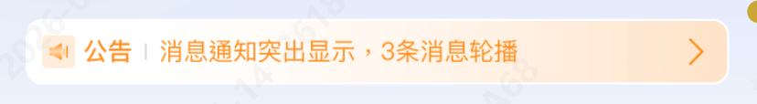

# 公告消息竖向轮播

需要实现如下图的效果，使用技术栈：react + antd mobile + vite 打包 + ahooks 项目


1. 组件定义

```tsx
// VerticalNotice.tsx
import React, { useMemo, useRef, useState } from 'react';
import { RightOutline, SoundOutline } from 'antd-mobile-icons';
import { useInterval, useMemoizedFn, useUnmount } from 'ahooks';

type VerticalNoticeProps = {
  items: string[];
  height?: number; // 单条高度(px)
  interval?: number; // 每条停留毫秒
  duration?: number; // 切换动画毫秒
  prefixText?: string; // 左侧前缀文案，如“公告”
  onItemClick?: (item: string, index: number) => void;
  className?: string;
  style?: React.CSSProperties;
};

const VerticalNotice: React.FC<VerticalNoticeProps> = ({
  items,
  height = 36,
  interval = 2500,
  duration = 380,
  prefixText = '公告',
  onItemClick,
  className,
  style,
}) => {
  const safeItems = Array.isArray(items) ? items.filter(Boolean) : [];
  const loopItems = useMemo(
    () => (safeItems.length > 0 ? [...safeItems, safeItems[0]] : []),
    [safeItems]
  );

  console.log('loopItems', loopItems);

  const [index, setIndex] = useState(0); // 当前滚动到的行
  const [animating, setAnimating] = useState(true); // 是否启用过渡动画
  const pausedRef = useRef(false);
  const wrapRef = useRef<HTMLDivElement>(null);
  const timerRef = useRef<number | null>(null);

  const goNext = useMemoizedFn(() => {
    if (pausedRef.current || safeItems.length <= 1) return;
    setAnimating(true);
    setIndex((prev) => prev + 1);
  });

  // 自动轮播
  useInterval(goNext, safeItems.length > 1 ? interval : undefined);

  // 过渡结束：如果到达“克隆的第一条”，瞬间跳回 index=0 以实现无缝
  const onTransitionEnd = useMemoizedFn(() => {
    if (safeItems.length === 0) return;
    if (index === safeItems.length) {
      setAnimating(false);
      // 下一帧再把 index 设回 0，避免看到回弹动画
      timerRef.current = window.setTimeout(() => {
        setIndex(0);
        // 再下一帧恢复动画
        timerRef.current = window.setTimeout(() => setAnimating(true), 20);
      }, 20);
    }
  });

  useUnmount(() => {
    if (timerRef.current) {
      clearTimeout(timerRef.current);
      timerRef.current = null;
    }
  });

  const pause = useMemoizedFn(() => {
    pausedRef.current = true;
  });
  const resume = useMemoizedFn(() => {
    pausedRef.current = false;
  });

  const containerStyle: React.CSSProperties = {
    display: 'flex',
    alignItems: 'center',
    height,
    padding: '0 12px',
    borderRadius: 12,
    background: 'linear-gradient(90deg, rgba(255,171,89,0.2), rgba(255,171,89,0.1))',
    color: '#FF7A00',
    overflow: 'hidden',
    ...style,
  };

  const listStyle: React.CSSProperties = {
    transform: `translateY(-${index * height}px)`,
    transition: animating ? `transform ${duration}ms ease-out` : 'none',
  };

  return (
    <div
      className={className}
      style={containerStyle}
      onMouseEnter={pause}
      onMouseLeave={resume}
      onTouchStart={pause}
      onTouchEnd={resume}
    >
      <SoundOutline style={{ fontSize: 16, marginRight: 6 }} />
      <span style={{ fontWeight: 600, marginRight: 6 }}>{prefixText}</span>
      <div
        ref={wrapRef}
        style={{
          flex: 1,
          height,
          overflow: 'hidden',
          lineHeight: `${height}px`,
        }}
      >
        <div style={listStyle} onTransitionEnd={onTransitionEnd}>
          {loopItems.length === 0 ? (
            <div style={{ height, color: '#999' }}>暂无消息</div>
          ) : (
            loopItems.map((txt, i) => (
              <div
                key={`${txt}-${i}`}
                style={{
                  height,
                  whiteSpace: 'nowrap',
                  overflow: 'hidden',
                  textOverflow: 'ellipsis',
                  color: '#FF7A00',
                  paddingRight: 8,
                  userSelect: 'none',
                }}
                onClick={() => onItemClick?.(safeItems[i % safeItems.length], i % safeItems.length)}
              >
                {txt}
              </div>
            ))
          )}
        </div>
      </div>
      <RightOutline style={{ fontSize: 16, color: '#FF7A00' }} />
    </div>
  );
};

export default VerticalNotice;
```

2. 引用组件

```tsx
import VerticalNotice from './VerticalNotice';

const msgs = [
  '我是商品资讯消息11111111111111',
  '我是商品资讯消息222222222222222222222222222222222222222222222222222',
  '我是商品资讯消息33333333333333333333',
];

export default () => {
  return (
    <div style={{ padding: 12, background: '#F7F8FA', minHeight: '100vh' }}>
      <VerticalNotice
        items={msgs}
        height={40}
        interval={2600}
        duration={380}
        prefixText='公告'
        onItemClick={(text, idx) => {
          // 这里可以跳转公告页或打开弹窗
          console.log('click item', idx, text);
        }}
      />
    </div>
  );
};
```
